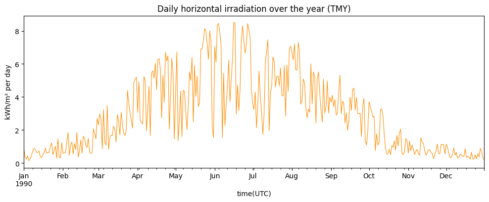
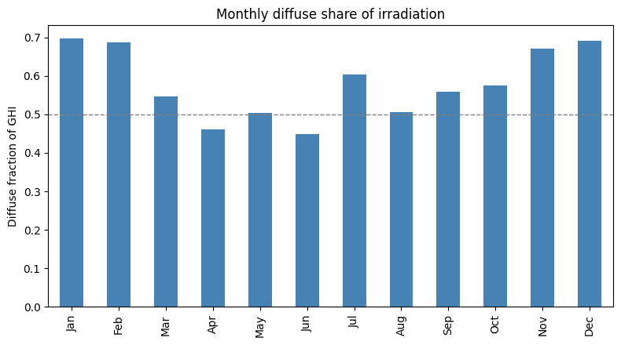
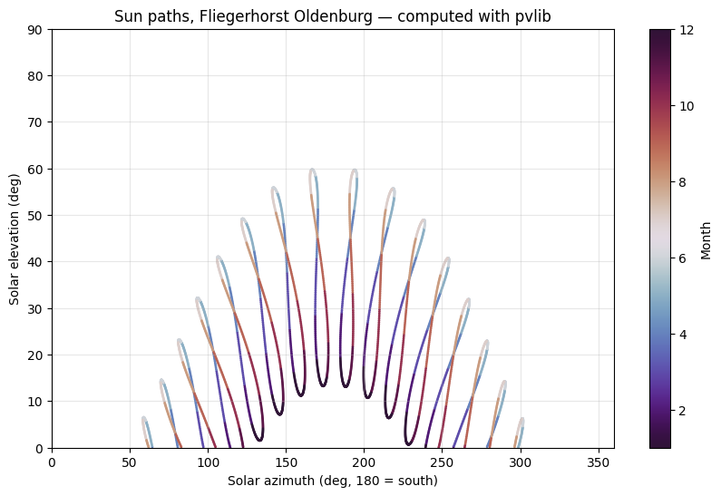
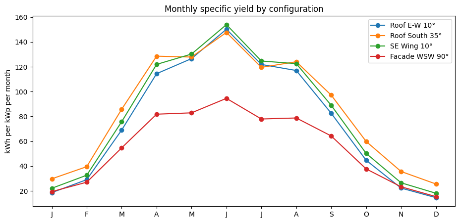
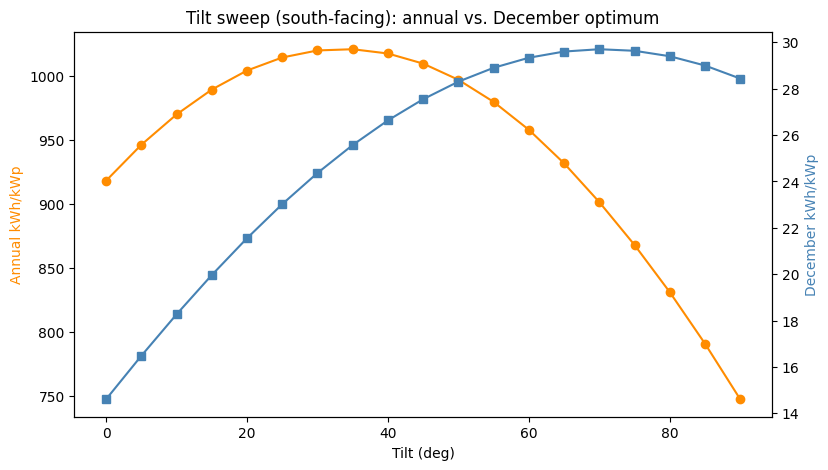
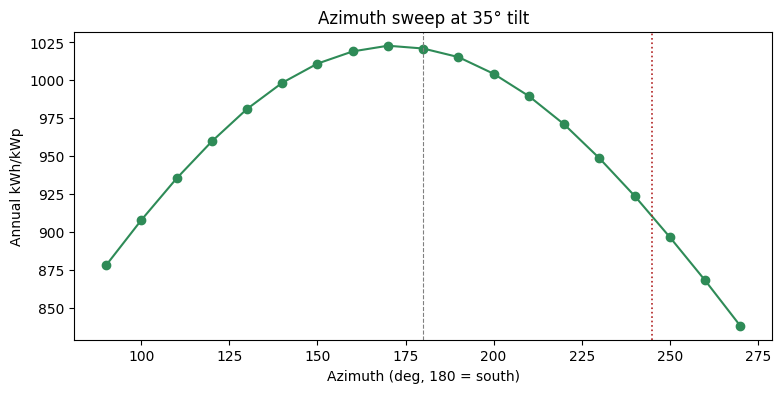
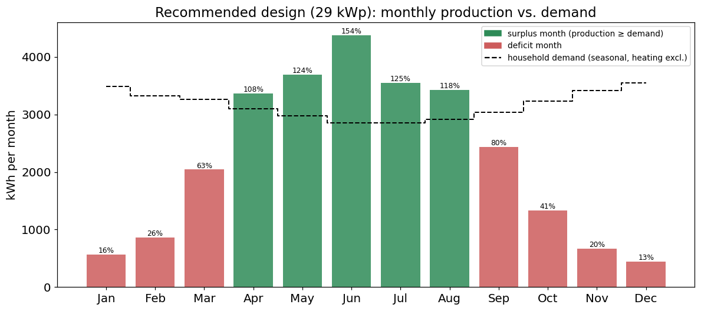

# Photovoltaic Configuration Study — Residential Building, Fliegerhorst Oldenburg

A collaborative university project examining photovoltaic (PV) layout options for a 14-unit residential development in Fliegerhorst, Oldenburg, Germany.

The study compares candidate PV configurations across roof, wing and façade surfaces. It considers solar resource characteristics, modelled PV energy yield, orientation sensitivity and an indicative building electricity-demand profile.

## Project overview

**Study location:** Melli-Beese-Ring 1, Fliegerhorst, Oldenburg, Germany  
**Site coordinates:** 53.17295° N, 8.18185° E  
**Building:** 14 residential units

The building geometry was interpreted from the supplied site plan, with measurements used to define candidate PV surfaces. The notebook then models the expected performance of different configurations using a PVGIS Typical Meteorological Year (TMY) weather dataset.

## Analysis workflow

1. Retrieve PVGIS TMY weather data for the project location using pvlib.
2. Examine the horizontal solar resource and solar-position characteristics.
3. Calculate plane-of-array irradiance for the candidate surface orientations.
4. Estimate module temperature using the Faiman temperature model.
5. Estimate PV DC output using the pvlib PVWatts model and simplified system/inverter loss factors.
6. Compare south-facing, east–west, wing and façade configurations.
7. Examine sensitivity to panel tilt and azimuth.
8. Compare an indicative 29 kWp roof-and-wing scenario with an assumed household electricity-demand profile.

## Selected figures

### Solar resource and geometry

**Daily horizontal irradiation**



**Diffuse irradiance share**



**Solar path**



### PV configuration analysis

**Monthly specific PV yield**



**Tilt-angle sensitivity**



**Azimuth sensitivity**



**Indicative PV production and building demand**



## Repository contents

- `notebooks/pv_configuration_analysis.ipynb` — Jupyter notebook containing the modelling workflow and analysis.
- `figures/` — exported figures used in this README.
- `requirements.txt` — Python package dependencies.

## Software and methods

- Python
- pvlib
- pandas
- NumPy
- Matplotlib
- PVGIS Typical Meteorological Year (TMY) data
- AutoCAD site-plan measurements

## Running the notebook

Create and activate a Python virtual environment, install the dependencies, and launch JupyterLab:

```bash
python -m venv .venv

# Windows PowerShell
.venv\\Scripts\\Activate.ps1

# macOS / Linux
source .venv/bin/activate

pip install -r requirements.txt
jupyter lab
```

Open `notebooks/pv_configuration_analysis.ipynb` from JupyterLab. The notebook retrieves TMY weather data from PVGIS at runtime, so an internet connection is required for that request.

## Assumptions and limitations

This is an academic design study based on supplied site-plan geometry and modelling assumptions. Results depend on usable roof area, module packing density, surface orientation and tilt, weather-year selection, temperature coefficients, shading treatment and assumed system losses.

The household electricity-demand profile is an estimate for comparison, not measured consumption. The model does not establish actual self-consumption, grid export, storage dispatch or financial performance.

The analysis uses a pvlib/PVWatts-based workflow. It is not an NREL System Advisor Model (SAM) simulation or a cross-validation against SAM.

Total annual energy (kWh) and specific yield (kWh/kWp) are different metrics and should be interpreted with the corresponding system capacity and assumptions.

## Project context

This work was completed collaboratively as part of a university project. The repository documents the analysis workflow and selected outputs; it should not be read as an attribution of the entire project to one individual.
